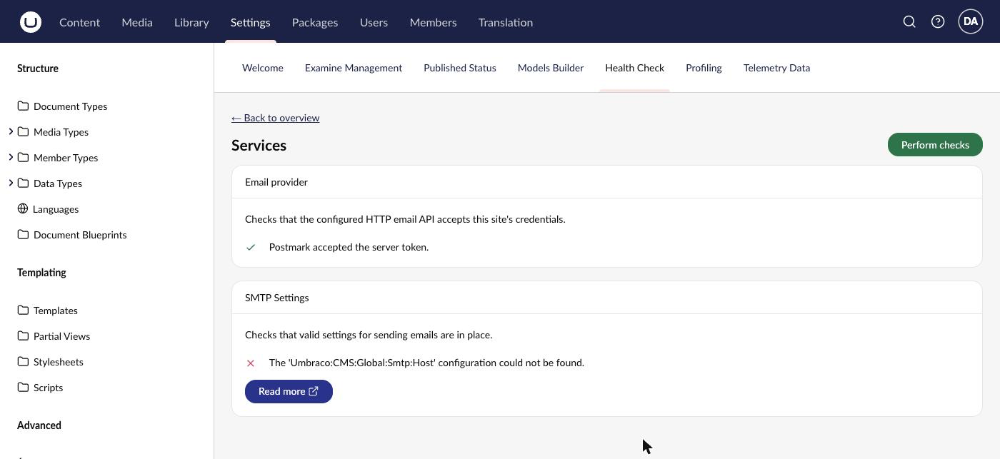

# Email Sender

Send every Umbraco email through an HTTP API instead of SMTP. Fifteen providers: Postmark, Azure Communication Services, GOV.UK Notify, SendGrid, Resend, Mailgun, Brevo, Mailjet, Bird, MailerSend, SMTP2GO, Elastic Email, Mandrill, Mailtrap and Microsoft Graph.

> **Alpha.** Read the status of your provider in the table below before you rely on it. Most providers are built from their documentation and recorded examples and have not been run against a live account.

[](https://github.com/PascalA94/Umbraco.Community.EmailSender/actions/workflows/build.yml)
[](https://www.nuget.org/packages/Umbraco.Community.EmailSender)
[](https://www.nuget.org/packages/Umbraco.Community.EmailSender)
[](https://github.com/PascalA94/Umbraco.Community.EmailSender/blob/main/LICENSE)



A community package, not made or supported by Umbraco HQ. Requires Umbraco 17 (17.8.0 or later) or Umbraco 18 (18.3.0 or later), on .NET 10.

## Compatibility

| Package version | Umbraco |
|---|---|
| 17.x | 17 (17.8.0 or later) |
| 18.x | 18 (18.3.0 or later) |

## Install

```bash
dotnet add package Umbraco.Community.EmailSender
```

## Quick start

Set the provider and its secret. Nothing else changes: password reset, user invites, content notifications and health-check emails all go through the API.

```json
{
  "EmailSender": {
    "Provider": "Postmark",
    "From": "noreply@example.com"
  }
}
```

Put the secret in an environment variable or a secret store, never in a committed `appsettings.json`:

```bash
EmailSender__Postmark__ServerToken=<your server token>
```

If `EmailSender:Provider` is not set, the package does nothing and Umbraco's SMTP settings stay in charge. A site with no `Umbraco:CMS:Global:Smtp:Host` still offers user invites and password reset once a provider is set.

## Settings

| Key | Default | Meaning |
|---|---|---|
| `EmailSender:Provider` | unset | One of the values in the [status table](#providers) (case-insensitive). Unset means this package is inactive. |
| `EmailSender:From` | unset | Used when a message has no From. Then `Umbraco:CMS:Global:Smtp:From` is tried. Not used by GOV.UK Notify. |
| `EmailSender:DisableLinkTracking` | `true` | Asks the provider not to rewrite links, so mail scanners do not consume invite links. |
| `EmailSender:TimeoutSeconds` | `30` | How long one provider call may take, 1 to 300. |
| `EmailSender:MaxTotalAttachmentBytes` | `10485760` | Largest total attachment size (raw bytes) before nothing is sent. Base64 adds about a third on the wire. |
| `EmailSender:Postmark:ServerToken` | none | **Secret.** A Postmark *server* token, not the account token. |
| `EmailSender:Postmark:MessageStream` | `outbound` | The message stream to send on. |
| `EmailSender:AzureCommunicationServices:ConnectionString` | none | **Secret.** `endpoint=https://<resource>.communication.azure.com/;accesskey=<key>`. |
| `EmailSender:GovUkNotify:ApiKey` | none | **Secret.** The full Notify API key. |
| `EmailSender:GovUkNotify:EmailTemplateId` | none | The id of your one email template (see below). |
| `EmailSender:GovUkNotify:ReplyToId` | unset | The id of a reply-to address registered in Notify. |

The keys for every other provider are in its guide under [Providers](#providers). Each provider's section is bound only when that provider is chosen.

A wrong or missing setting stops the site at start-up with a message that names the key, never the value. These keys are permanent: they will not be renamed within a major version.

A change to `Provider` needs a restart, because it decides which services are registered. Other settings are read on every send.

## Providers

### Status

A label says what has been proven, nothing more. A provider is never described here as working beyond its label.

| Provider | `Provider` value | Status | Caveats |
|---|---|---|---|
| Postmark | `Postmark` | Built from the provider's docs and checked against recorded examples | [Postmark](#postmark) |
| Azure Communication Services | `AzureCommunicationServices` | Unverified. Microsoft retires ACS Email on 30 Sep 2028 | [ACS](#azure-communication-services) |
| GOV.UK Notify | `GovUkNotify` | Unverified, Experimental | [Notify](#govuk-notify) |
| SendGrid | `SendGrid` | Built from the provider's docs and checked against recorded examples | [SendGrid](#sendgrid) |
| Resend | `Resend` | Built from the provider's docs and checked against recorded examples | [Resend](#resend) |
| Mailgun | `Mailgun` | Built from the provider's docs and checked against recorded examples | [Mailgun](#mailgun) |
| Brevo | `Brevo` | Built from the provider's docs and checked against recorded examples | [Brevo](#brevo) |
| Mailjet | `Mailjet` | Built from the provider's docs and checked against recorded examples | [Mailjet](#mailjet) |
| Bird | `Bird` | Built from the provider's docs and checked against recorded examples | [Bird](#bird) |
| MailerSend | `MailerSend` | Built from the provider's docs and checked against recorded examples | [MailerSend](#mailersend) |
| SMTP2GO | `Smtp2Go` | Built from the provider's docs and checked against recorded examples | [SMTP2GO](#smtp2go) |
| Elastic Email | `ElasticEmail` | Built from the provider's docs and checked against recorded examples | [Elastic Email](#elastic-email) |
| Mandrill | `Mandrill` | Built from the provider's docs and checked against recorded examples | [Mandrill](#mandrill) |
| Mailtrap | `Mailtrap` | Built from the provider's docs and checked against recorded examples | [Mailtrap](#mailtrap) |
| Microsoft Graph | `MicrosoftGraph` | Built from the provider's docs and checked against recorded examples | [Graph](#microsoft-graph) |

- **Verified live:** the maintainer ran a real send on both Umbraco lines and recorded it. No provider has this label yet.
- **Built from the provider's docs and checked against recorded examples:** the request shape follows the provider's documentation, the package's conformance tests pass, and the provider has a recorded example request and a documented success signal. It has not been run against a live account.
- **Unverified:** built and unit tested, with no recorded examples and no live check.
- **Experimental:** not proven where it matters most.

Free tiers are as of November 2026 and change. Check the provider's own pricing page.

### What every provider shares

- Up to 50 recipients (To, Cc and Bcc together) per email. A provider with a lower limit refuses earlier, before anything is sent.
- A request that would go over the provider's size limit is refused before it is sent, with the limit named.
- **Retries are cautious**, because a duplicate invite is worse than a failed one. A 429 or 503 (and Mailgun's 420) is retried up to three attempts in total, waiting for `Retry-After` when it is short. A 500, 502, 504 or a lost connection is retried only where the provider documents an idempotency key (Resend, Bird, Brevo). A timeout and any 4xx are never retried, except that Microsoft Graph repeats a 401 once with a fresh token. Azure Communication Services and Elastic Email are never retried after a 5xx or a lost connection.
- The whole send, retries included, shares one `TimeoutSeconds` budget.
- An error carries the HTTP status and a numeric code or class name, never the provider's own message text.

### Postmark

Create a server, use its **Server API token** (the narrowest key that can send; not the account token), and give the sending domain a verified signature. With `DisableLinkTracking` on, each message is sent with `TrackLinks` set to `None` and `TrackOpens` off. Rotate a token in the server's API Tokens tab. Free tier (as of November 2026): the Developer plan, 100 a month, no card. While the account is pending approval, recipients must share the From domain. Postmark keeps the body of sent messages in its activity log, invite and reset links included.

What has been run live: on 2026-11-24, on Umbraco 18 only, against a Postmark Sandbox server, the health check passed and an invite and a password-reset email were accepted. Umbraco 17, link tracking, content notifications and the failure cases were not checked, so the label stays as it is.

### Azure Communication Services

Create an Email Communication Services resource with a verified domain, connect it to a Communication Services resource, and use that resource's connection string. Use a resource that only this site uses, so a leak is contained. The sender address (`EmailSender:From` or the Smtp From) must be a MailFrom address on the verified domain. A display name in the From setting is dropped.

- The endpoint must be `https` on a `*.communication.azure.com`, `.us` or `.cn` host. Another host is refused at send time, and there is no setting to override it.
- With `DisableLinkTracking` on, each message asks the service not to track user engagement. Also turn off user engagement tracking on the domain: the domain setting applies to any message that does not carry the switch.
- The package does not wait for delivery. It stops once Azure has accepted the request, and logs the operation id.
- Retries are off, because a retry after a lost answer could send an invite twice.
- **Microsoft retires ACS Email on 30 Sep 2028.** Free tier: Azure usage pricing applies.
- The Azure resource's region decides where data is kept. This package makes no claim about it.

### GOV.UK Notify

Notify sends from templates, so the package uses **one email template** for everything:

- Subject: `((subject))`
- Body: `((body))`

Put the template's id in `EmailSender:GovUkNotify:EmailTemplateId`. The health check warns when the template does not look like this.

What to expect:

- Notify shows HTML as text, so an HTML message is reduced to plain text. Links to `http` and `https` addresses stay as links. Layout and images are lost.
- Notify sends from the address set up in your Notify service. `EmailSender:From` is not used. A reply-to address in a message is ignored (with a warning in the log); set `ReplyToId` to use one registered in Notify.
- One request goes out per recipient in `To`, up to 50. If a later one fails, the error says how many were sent.
- **Attachments, Cc and Bcc are not supported** and fail with a clear message before anything is sent.
- A team-only key, or a service in trial mode, can only send to team members. The error says so.
- Notify does not track links.
- Free tier: Notify is for public sector services only. Live or team keys need a service in Notify.
- Square brackets in message text are shown as round brackets, so text from a content editor or a form cannot form a Markdown link in an email that comes from your Notify sender.
- A retry after a partial failure sends to the earlier recipients again.
- Use a dedicated **live** key for this site, kept in an environment variable or secret store. Revoke and replace it under API integration, API keys in Notify. Notify shows recent notifications, personalisation included, to your Notify team, and an invite or reset link is a credential: keep the team small and Umbraco's token lifetimes short.

The guides below follow one pattern: the key to use, the settings (environment variables first, then JSON with placeholders), what the provider needs verified before it sends, the free tier as of November 2026, and the caveats. Set `EmailSender:Provider` and `EmailSender:From` as in the quick start; the From address must be one the provider will send as.

### SendGrid

- **Key:** an API key with the Mail Send permission only.
- **Settings:**
  ```bash
  EmailSender__SendGrid__ApiKey=<api key>
  EmailSender__SendGrid__Region=Global   # or EU
  ```
  ```json
  { "EmailSender": { "Provider": "SendGrid", "SendGrid": { "Region": "Global" } } }
  ```
- **Verify first:** Single Sender Verification or Domain Authentication.
- **Free tier:** no free plan; a 60-day trial at 100 a day.
- **Caveats:** the EU region needs a Pro plan, an EU subuser's key and `Region: EU`. With `DisableLinkTracking` on, click and open tracking are switched off on each message.

### Resend

- **Key:** an API key with sending access.
- **Settings:**
  ```bash
  EmailSender__Resend__ApiKey=<api key>
  ```
  ```json
  { "EmailSender": { "Provider": "Resend" } }
  ```
- **Verify first:** `onboarding@resend.dev` sends to your own address only. Anything else needs a verified domain.
- **Free tier:** 3,000 a month, 100 a day.
- **Caveats:** tracking is a domain setting in Resend (off by default), so `DisableLinkTracking` cannot change it per message. Resend's documentation says account data is stored in the US whatever the sending region.

### Mailgun

- **Key:** a Domain Sending Key.
- **Settings:**
  ```bash
  EmailSender__Mailgun__ApiKey=<sending key>
  EmailSender__Mailgun__Domain=mg.example.com
  EmailSender__Mailgun__Region=US   # or EU
  ```
  ```json
  { "EmailSender": { "Provider": "Mailgun", "Mailgun": { "Domain": "mg.example.com", "Region": "US" } } }
  ```
- **Verify first:** a sandbox domain with up to five authorised recipients, or a verified domain.
- **Free tier:** 100 a day.
- **Caveats:** `Domain` is required and `Region` must match the region the domain was created in. With `DisableLinkTracking` on, tracking is switched off on each message.

### Brevo

- **Key:** an API key (v3).
- **Settings:**
  ```bash
  EmailSender__Brevo__ApiKey=<api key>
  ```
  ```json
  { "EmailSender": { "Provider": "Brevo" } }
  ```
- **Verify first:** a validated sender or an authenticated domain, and account approval before the first send.
- **Free tier:** 300 a day after approval, no card.
- **Caveats:** tracking is an account setting, so `DisableLinkTracking` cannot change it per message. Custom headers (the `Expires` header) are not sent. If you use Brevo's "Block unknown IP addresses" setting, it can refuse the site.

### Mailjet

- **Key:** an API key (public) and its Secret Key.
- **Settings:**
  ```bash
  EmailSender__Mailjet__ApiKey=<public key>
  EmailSender__Mailjet__SecretKey=<secret key>
  ```
  ```json
  { "EmailSender": { "Provider": "Mailjet" } }
  ```
- **Verify first:** a validated sender or domain.
- **Free tier:** 6,000 a month, 200 a day, no card.
- **Caveats:** one Reply-To address only. With `DisableLinkTracking` on, click and open tracking are disabled on each message.

### Bird

- **Key:** a workspace key (`bk_...`).
- **Settings:**
  ```bash
  EmailSender__Bird__ApiKey=<workspace key>
  EmailSender__Bird__Region=us1   # or eu1
  ```
  ```json
  { "EmailSender": { "Provider": "Bird", "Bird": { "Region": "us1" } } }
  ```
- **Verify first:** `onboarding@messagebird.dev` sends to workspace members only. Anything else needs a verified domain.
- **Free tier:** 1,000 a month, 50 a day, no card.
- **Caveats:** `Region` is fixed at sign-up and the key must match it (a 421 means a mismatch). System emails go as `transactional`. Whether Bird treats the `Expires` header as reserved is not confirmed; it is sent, and a failure naming a header means it should be dropped for Bird.

### MailerSend

- **Key:** an API token for the sending domain.
- **Settings:**
  ```bash
  EmailSender__MailerSend__ApiKey=<api token>
  ```
  ```json
  { "EmailSender": { "Provider": "MailerSend" } }
  ```
- **Verify first:** a verified domain, or the trial domain.
- **Free tier:** 500 a month; needs a card and account approval.
- **Caveats:** until the account is approved, one recipient per email. Custom headers are dropped (they need the Professional plan). One Reply-To address only.

### SMTP2GO

- **Key:** an API key (`api-...`).
- **Settings:**
  ```bash
  EmailSender__Smtp2Go__ApiKey=<api key>
  EmailSender__Smtp2Go__Region=Global   # or US, EU, AU
  ```
  ```json
  { "EmailSender": { "Provider": "Smtp2Go", "Smtp2Go": { "Region": "Global" } } }
  ```
- **Verify first:** a verified domain or a single sender (not a Gmail or Yahoo address).
- **Free tier:** 1,000 a month, 200 a day; a work email and an SMS code at sign-up.
- **Caveats:** open and click tracking are settings on the API key, so `DisableLinkTracking` cannot change them per message. `Global` uses the nearest region; pick `US`, `EU` or `AU` to choose one.

### Elastic Email

- **Key:** an API key with the SendHttp access level.
- **Settings:**
  ```bash
  EmailSender__ElasticEmail__ApiKey=<api key>
  ```
  ```json
  { "EmailSender": { "Provider": "ElasticEmail" } }
  ```
- **Verify first:** a verified domain or sender. The address you signed up with is pre-verified.
- **Free tier:** 100 a day in the free phase.
- **Caveats:** the provider's error bodies are not documented, so an error shows the HTTP status only. The `Idempotency-Key` header appears only in the vendor's OpenAPI, so a 5xx or a lost connection is never retried until a live check confirms it.

### Mandrill

- **Key:** a Mandrill (Mailchimp Transactional) API key.
- **Settings:**
  ```bash
  EmailSender__Mandrill__ApiKey=<api key>
  ```
  ```json
  { "EmailSender": { "Provider": "Mandrill" } }
  ```
- **Verify first:** a verified domain with SPF and DKIM (not a Gmail or Yahoo address).
- **Free tier:** none. It needs a Mailchimp Standard plan or a Transactional block.
- **Caveats:** Mandrill takes the key in the request body, which this package never logs. Results come per recipient, and one rejected recipient fails the whole send even though the others were accepted: the error says so, so do not resend the whole email.

### Mailtrap

- **Key:** an Email Sending API token (not a Sandbox token).
- **Settings:**
  ```bash
  EmailSender__Mailtrap__ApiKey=<api token>
  ```
  ```json
  { "EmailSender": { "Provider": "Mailtrap" } }
  ```
- **Verify first:** a verified domain, or the demo domain to your own address.
- **Free tier:** 4,000 a month, 150 a day.
- **Caveats:** tracking is not set per request, so `DisableLinkTracking` cannot change it. One Reply-To address only. A 401 can also mean an unverified domain.

### Microsoft Graph

> **Read this first.** The `Mail.Send` application permission lets the app send as **any mailbox in the tenant**. Restrict it with **RBAC for Applications** in Exchange Online, scoped to a management scope that holds only the sending mailbox, and then remove the tenant-wide Entra `Mail.Send` grant, because the two are additive. This package cannot enforce that for you.

- **Key:** an Entra app registration: tenant id, client id and a client secret. Certificate credentials are not supported yet.
- **Settings:**
  ```bash
  EmailSender__MicrosoftGraph__TenantId=<tenant id>
  EmailSender__MicrosoftGraph__ClientId=<client id>
  EmailSender__MicrosoftGraph__ClientSecret=<client secret>
  EmailSender__MicrosoftGraph__SenderUserId=<mailbox address or object id>
  ```
  ```json
  { "EmailSender": { "Provider": "MicrosoftGraph", "MicrosoftGraph": { "TenantId": "<tenant id>", "ClientId": "<client id>", "SenderUserId": "noreply@example.com" } } }
  ```
- **Verify first:** a licensed Exchange Online mailbox, and the `Mail.Send` application permission with admin consent.
- **Free tier:** none. It needs a Microsoft 365 tenant.
- **Caveats:** Graph sends as `SenderUserId`, so `EmailSender:From` is not used. Non-`x-` headers are dropped, attachments over 3 MB are refused, and only a 429 is retried (Graph has no idempotency key). Graph returns no message id and keeps no copy unless `SaveToSentItems` is on, so a failure after acceptance arrives as a bounce and the only trace is Exchange message trace. Sent mail is not copied to Sent Items by default.

## Health check

A check named "Email provider" appears under Services in the Health Check dashboard. It confirms that the provider accepts the credentials without sending an email: Postmark and GOV.UK Notify make an authenticated read, and Microsoft Graph requests a token, all without sending an email. Every other provider reports Info ("credentials are not checked without sending"), because no read-only call proves a sending-only key. Azure only proves that the endpoint answers over TLS (it cannot prove sending works without sending).

Umbraco's own "SMTP Settings" health check still tests SMTP and will fail on a site with no SMTP host. Ignore it.

## Security notes

- Secrets are read from configuration only. They are never stored in the database, and never appear in logs, exception text, health-check text or `ToString()`.
- Recipient addresses and subjects are never logged. Logs carry the provider name, the recipient count, the attachment count, the provider's message id and the elapsed time.
- Error messages carry the HTTP status and the provider's error code or class name. The provider's response text is never copied, because an API can echo what it was sent.
- HTTP clients follow no redirects, so a credential is never sent to another host.
- Invite and reset links are bearer secrets. Keep `DisableLinkTracking` on so a provider does not rewrite or log them.
- Do not add a host-wide resilience or retry handler (for example `ConfigureHttpClientDefaults` with `AddStandardResilienceHandler`). It would retry a POST that may already have been accepted and send an email twice.
- A message reply-to is not sent by Notify (see above), so replies go to the reply-to registered in Notify.
- Do not turn on host-wide HTTP body logging for the `community.emailSender.*` clients: request bodies hold the recipient and the message. This package removes the factory's own logging from its clients because that logs credential headers at Trace.
- Report a vulnerability as described in `SECURITY.md`.

## Limits

- No templates, queues or bounce handling. Retries are limited to the rules under [What every provider shares](#what-every-provider-shares).
- Member-facing and marketing email is out of scope. Anything that calls Umbraco's `IEmailSender` is covered.
- Attachments are read into memory before sending, up to `MaxTotalAttachmentBytes`.

## Uninstall

Remove the package (or just the `EmailSender:Provider` setting). Umbraco's SMTP settings take over again at the next start. Nothing is written to the database.

## Develop

See `.github/CONTRIBUTING.md` and `CLAUDE.md` for the commands. In short: `./scripts/test.sh` builds and tests both Umbraco lines (17 and 18) from this one branch; run the demo site under `demo/`.

## Licence

MIT. See `LICENSE`. Security issues: see `SECURITY.md`.
